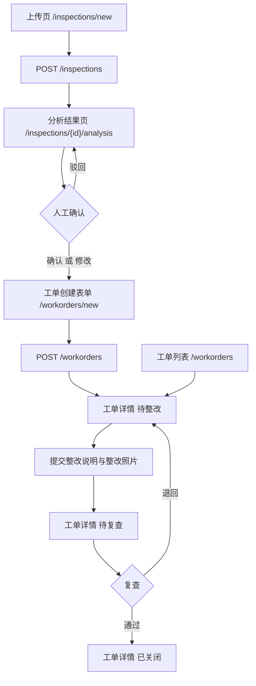

# LabGuard AI — C 模块设计契约

- 负责人：成员 C（Web 页面与交互）
- 版本：v1.0
- 对应任务：10/16 需求冻结与工程初始化
- 状态：待 A / B / D 确认后冻结
- 约束：本文档冻结后，任何字段变更须先改本文档，再同步相关成员

## 0. 全局约定

| 项 | 约定 |
|---|---|
| 渲染方式 | Thymeleaf 服务端渲染，不做前后端分离 |
| 写操作 | 一律 POST + 重定向（PRG），防止刷新重复提交 |
| 状态控制 | 页面仅按状态隐藏按钮；**合法性由 WorkOrderService 校验**，非法请求由后端拒绝并返回可读错误 |
| 数据访问 | 页面层与 Controller 不直接访问数据库 |
| 图片存储 | 由 D 提供统一存储路径与访问 URL 规则 |
| 来源标识 | `source` 为 REAL / DEMO，任何页面不得缺失该标识 |
| 样式 | 统一放 `static/css/app.css`，禁止页面内联样式 |

## 1. 页面流程图



文字版：
1. 上传页 → 提交 → 分析结果页
2. 分析结果页逐条风险：确认 / 修改 / 驳回（驳回后停留原页）
3. 确认后 → 工单创建表单 → 提交 → 工单详情（待整改）
4. 工单详情提交整改说明 + 整改照片 → 状态变待复查
5. 待复查：通过 → 已关闭；退回 → 回待整改（新增复查意见，历史不清空）
6. 工单列表可随时进入任意详情

## 2. 路由清单

| 编号 | 方法 | 路径 | 视图 / 动作 | 主要参数 | 前置条件 | 成功 | 失败 |
|---|---|---|---|---|---|---|---|
| R1 | GET | `/` | 重定向到 R2 | — | — | 302 | — |
| R2 | GET | `/inspections/new` | `inspection-form` | — | — | 200 | — |
| R3 | POST | `/inspections` | 保存图片 → 调用 A 分析 | `file` `labName` `inspector` `inspectionTime` `note` | 文件与表单校验通过 | 302 → R4 | 回 R2 + 字段级错误 |
| R4 | GET | `/inspections/{id}/analysis` | `analysis` | path `id` | 巡检记录存在 | 200 | 404 |
| R5 | POST | `/hazards/{id}/confirm` | 保存人工确认 | `action` `reviewNote` + 可编辑风险字段 | hazard 属于该巡检且未建单 | 302 → R4 | 回 R4 + 错误 |
| R6 | GET | `/workorders` | `workorders` | `status`（可选筛选） | — | 200 | — |
| R7 | GET | `/workorders/new` | `workorder-form` | `hazardId` | hazard 已确认且未关联工单 | 200 | 302 → R4 + 错误 |
| R8 | POST | `/workorders` | 创建工单 | `hazardId` `assignee` `dueDate` `note` | hazard 已确认 | 302 → R9 | 回 R7 + 错误 |
| R9 | GET | `/workorders/{id}` | `workorder-detail` | path `id` | 工单存在 | 200 | 404 |
| R10 | POST | `/workorders/{id}/remediation` | 提交整改 | `remediationNote` `afterImage` | 状态 = 待整改 | 302 → R9 | 回 R9 + 错误 |
| R11 | POST | `/workorders/{id}/review` | 复查 | `action`(PASS/RETURN) `reviewComment` | 状态 = 待复查 | 302 → R9 | 回 R9 + 错误 |

模板文件（`src/main/resources/templates/`）：

```
inspection-form.html    R2
analysis.html           R4
workorder-form.html     R7
workorders.html         R6
workorder-detail.html   R9
error/404.html  error/5xx.html   （与 D 的全局异常处理共用）
```

## 3. 表单字段清单

### F1 上传表单（R2 / R3）

| 字段 | name | 控件 | 必填 | 校验规则 | 错误提示 |
|---|---|---|---|---|---|
| 实验室照片 | `file` | file | 是 | 非空；仅 `image/jpeg`、`image/png`；≤ 5MB | 请选择 JPG 或 PNG 图片，且大小不超过 5MB |
| 实验室名称 | `labName` | text | 是 | 1~50 字符 | 请填写实验室名称 |
| 巡检人 | `inspector` | text | 是 | 1~30 字符 | 请填写巡检人姓名 |
| 巡检时间 | `inspectionTime` | datetime-local | 否 | 不晚于当前时间 | 巡检时间不能晚于当前时间 |
| 备注 | `note` | textarea | 否 | ≤ 200 字符 | 备注不能超过 200 字 |

### F2 人工确认表单（R5）

| 字段 | name | 控件 | 必填 | 说明 |
|---|---|---|---|---|
| 操作类型 | `action` | radio | 是 | `CONFIRM` / `EDIT` / `REJECT` |
| 风险类别 | `category` | select | EDIT 时必填 | 从字典取值 |
| 位置描述 | `location` | text | EDIT 时必填 | ≤ 100 字符 |
| 可见证据 | `evidence` | textarea | EDIT 时必填 | ≤ 300 字符 |
| 建议措施 | `suggestedAction` | textarea | EDIT 时必填 | ≤ 300 字符 |
| 风险等级 | `riskLevel` | select | EDIT 时必填 | `HIGH` / `MEDIUM` / `LOW` |
| 驳回理由 | `reviewNote` | textarea | REJECT 时必填 | ≤ 200 字符 |

### F3 工单创建表单（R7 / R8）

| 字段 | name | 控件 | 必填 | 校验规则 |
|---|---|---|---|---|
| 隐患编号 | `hazardId` | hidden | 是 | 必须为已确认且未建单的隐患 |
| 责任人 | `assignee` | text | 是 | 1~30 字符 |
| 截止日期 | `dueDate` | date | 是 | 不早于今天 |
| 备注 | `note` | textarea | 否 | ≤ 200 字符 |

### F4 整改提交表单（R10）

| 字段 | name | 控件 | 必填 | 校验规则 |
|---|---|---|---|---|
| 整改说明 | `remediationNote` | textarea | 是 | 1~500 字符 |
| 整改后照片 | `afterImage` | file | 是 | 仅 JPG/PNG，≤ 5MB |

依据：未提交整改说明和必要证据时，不能进入待复查。

### F5 复查表单（R11）

| 字段 | name | 控件 | 必填 | 说明 |
|---|---|---|---|---|
| 复查结论 | `action` | radio | 是 | `PASS` / `RETURN` |
| 复查意见 | `reviewComment` | textarea | RETURN 时必填 | ≤ 300 字符 |

## 4. 展示字段清单（交付 A：视觉服务）

### S1 分析结果页（R4）

顶部通栏：

| 字段 | 来源 | 呈现要求 |
|---|---|---|
| `source` | A | REAL → 绿色「真实 AI 分析」；DEMO → 醒目黄色「演示数据，非真实识别结果」 |

巡检信息区：`labName` `inspector` `inspectionTime` `note`（B）、原图预览（D）

风险卡片区（`th:each` 遍历）：

| 字段 | 类型 | 页面呈现 | 缺失时 |
|---|---|---|---|
| `category` | String | 标签 + 中文名 | 显示「未分类」 |
| `riskLevel` | Enum | 彩色徽章 + 标注「建议」 | 显示「待评估」 |
| `location` | String | 普通文本 | 显示「位置未说明」 |
| `evidence` | String | 高亮卡片，核心依据 | 显示「无可见证据」并强制 needsHumanReview |
| `confidence` | Double 0~1 | 进度条 + 百分比 + 档位文字 | 显示「未提供」，不得填默认值 |
| `needsHumanReview` | Boolean | true → 黄色警示条「此结果需人工现场核实」 | 默认按 true 处理 |
| `suggestedAction` | String | 有序列表 | 显示「暂无建议」 |

卡片操作：确认 / 修改 / 驳回 → 均提交至 R5

### S2 工单列表（R6）

工单编号、隐患类别、建议风险等级、实验室、责任人、截止日期、状态标签、查看详情
筛选：`status` 下拉（全部 / 待整改 / 待复查 / 已关闭）

### S3 工单详情（R9）

| 区块 | 字段 |
|---|---|
| 基本信息 | 工单编号、关联隐患编号、实验室、责任人、截止日期、创建时间 |
| 整改前后对比 | 见附录 E |
| 复查记录 | 复查结论、复查意见、复查时间、复查人 |
| 操作区 | 按状态显隐（见第 5 节） |

## 5. 状态与按钮显隐矩阵（交付 B：工作流）

### 5.1 状态归属建议

工作流文档描述的状态链是「待确认 → 待整改 → 待复查 → 已关闭」，但规则同时要求「未人工确认的风险不能创建工单」。若工单必须在确认后才创建，则工单不存在「待确认」状态。

建议拆分为两个对象各自维护状态：

| 对象 | 状态 | 说明 |
|---|---|---|
| `Hazard` | `PENDING_CONFIRM` / `CONFIRMED` / `REJECTED` | 人工确认状态，对应「待确认」环节 |
| `WorkOrder` | `PENDING_REMEDIATION` / `PENDING_REVIEW` / `CLOSED` | 工单创建即进入待整改 |

依据：`项目说明文档` 5.3 中 Hazard 已包含「人工确认状态」，WorkOrder 状态为待整改 / 待复查 / 已关闭。

### 5.2 按钮显隐矩阵

| WorkOrder 状态 | 提交整改 | 复查通过 | 退回整改 | 编辑 |
|---|:---:|:---:|:---:|:---:|
| `PENDING_REMEDIATION` | ✅ | ❌ | ❌ | ✅ |
| `PENDING_REVIEW` | ❌ | ✅ | ✅ | ❌ |
| `CLOSED` | ❌ | ❌ | ❌ | ❌ |

| Hazard 确认状态 | 确认 | 修改 | 驳回 | 创建工单 |
|---|:---:|:---:|:---:|:---:|
| `PENDING_CONFIRM` | ✅ | ✅ | ✅ | ❌ |
| `CONFIRMED` | ❌ | ❌ | ❌ | ✅ |
| `REJECTED` | ❌ | ❌ | ❌ | ❌ |

## 6. 错误提示统一约定

| 场景 | 页面表现 |
|---|---|
| 字段校验失败 | 原位标红 + 字段下方提示，保留已填内容 |
| 文件类型 / 大小非法 | 回上传页，顶部红色提示 |
| 视觉 API 未配置 | 「视觉 API 未配置完整，请检查 VISION_MODE / VISION_API_KEY」，不展示任何风险数据 |
| 视觉 API 调用失败 | 「AI 分析失败：{错误类别}」，提供重试入口，不得回退为伪造结果 |
| 非法状态跳转 | 「当前状态（{当前}）不允许该操作」，回到详情页 |
| 资源不存在 | 404 错误页 |

## 7. 待确认事项

| # | 事项 | 需谁确认 | 影响 |
|---|---|---|---|
| 1 | Hazard / WorkOrder 状态是否按 5.1 拆分 | B | 按钮显隐、模板条件判断 |
| 2 | 风险类别字典取值 | A | 结果页标签、筛选 |
| 3 | `HazardItem` 确切字段名与嵌套结构 | A | `th:each` 绑定 |
| 4 | 图片存储目录与访问 URL 规则 | D | 原图与整改照片展示 |
| 5 | 是否需要独立巡检记录列表页 | 全员 | 若需要则新增 R0 |
| 6 | AuditEvent 是否在详情页展示 | B | 详情页时间线区块 |
| 7 | 置信度档位阈值口径（附录 B） | A | 进度条档位 |
| 8 | 是否需要 `riskLevelSource` 字段（附录 D） | B | 建议等级溯源 |
| 9 | multipart 大小配置（附录 F） | D | 上传功能是否可用 |

## 附录 A｜MVC 测试用例清单

技术：`@WebMvcTest` + `MockMvc`，Service 层用 `@MockBean` 桩替换。

### A1 InspectionControllerTest（10/17）
| 用例 | 断言 |
|---|---|
| 上传合法 JPG | 302 重定向到 `/inspections/{id}/analysis` |
| 空文件 | 200 回表单，含「请选择图片」 |
| 上传 `.txt` / `.pdf` | 200 回表单，含类型错误提示 |
| 上传 6MB 图片 | 200 回表单，含大小错误提示 |
| `labName` 为空 | 字段级错误，保留已填内容 |
| `inspector` 为空 | 字段级错误 |
| `inspectionTime` 为未来时间 | 字段级错误 |

### A2 AnalysisControllerTest（10/18）
| 用例 | 断言 |
|---|---|
| 正常结果 | 页面含 category / evidence / suggestedAction 文本 |
| `source=DEMO` | 页面含「演示数据」标识 |
| `source=REAL` | 页面不含「演示数据」 |
| `confidence=null` | 显示「未提供」，不显示 0% |
| `needsHumanReview=true` | 含「需人工现场核实」警示 |
| API 未配置 | 显示「视觉 API 未配置完整」，且不渲染任何风险卡片 |
| API 抛异常 | 显示错误类别 + 重试入口 |

### A3 ConfirmControllerTest（10/19）
| 用例 | 断言 |
|---|---|
| action=CONFIRM | 确认状态变更，重定向回分析页 |
| action=EDIT + 修改 | 保存修改值 |
| action=REJECT 无 `reviewNote` | 校验失败，回原页 |
| 已建单的 hazard 再次确认 | 被拒绝 |

### A4 WorkOrderControllerTest（10/19）
| 用例 | 断言 |
|---|---|
| 正常创建 | 302 → 详情页 |
| `hazardId` 未确认 | 拒绝，提示「风险未确认，不能创建工单」 |
| `dueDate` 早于今天 | 字段级错误 |
| `assignee` 为空 | 字段级错误 |

### A5 RemediationControllerTest（10/20）
| 用例 | 断言 |
|---|---|
| 待整改状态提交 | 302，状态变待复查 |
| 待复查状态重复提交 | 拒绝，提示「当前状态不允许该操作」 |
| 无整改照片 | 校验失败 |
| 无整改说明 | 校验失败 |

### A6 ReviewControllerTest（10/20）
| 用例 | 断言 |
|---|---|
| action=PASS | 状态变 CLOSED |
| action=RETURN 无意见 | 校验失败 |
| action=RETURN 有意见 | 状态回待整改，意见持久化 |
| 已关闭工单再操作 | 拒绝 |

### A7 按钮显隐断言（10/20）
| 用例 | 断言 |
|---|---|
| 待整改详情页 | 含「提交整改」，不含「复查通过」「退回整改」 |
| 待复查详情页 | 含「复查通过」「退回整改」，不含「提交整改」 |
| 已关闭详情页 | 三者均不含 |

## 附录 B｜置信度档位与配色

| 区间 | 文字 | 颜色 | 附注 |
|---|---|---|---|
| ≥ 0.80 | 高 | 绿 | 页面注明「模型自评，仅供参考」 |
| 0.50 ~ 0.79 | 中 | 橙 | 同上 |
| < 0.50 | 低 | 红 | 自动置 needsHumanReview=true |
| null | 未提供 | 灰 | 不得显示 0%，不得填充默认值 |

置信度仅代表模型对自身判断的估计，不得作为风险等级或工单状态的依据。

## 附录 C｜状态与徽章规范

| 状态 | 中文文案 | 文字色 | 底色 |
|---|---|---|---|
| PENDING_CONFIRM | 待确认 | 灰 | #F3F4F6 |
| CONFIRMED | 已确认 | 青 | #E0F2FE |
| REJECTED | 已驳回 | 灰 | #F3F4F6 |
| PENDING_REMEDIATION | 待整改 | 橙 | #FEF3C7 |
| PENDING_REVIEW | 待复查 | 蓝 | #DBEAFE |
| CLOSED | 已关闭 | 绿 | #D1FAE5 |

风险等级徽章：HIGH `#DC2626` / MEDIUM `#EA580C` / LOW `#CA8A04`

## 附录 D｜风险等级的语义约束

- 页面统一显示为「建议风险等级」，不得简写为「风险等级」
- 徽章旁固定小字：「由规则模块依据类别给出，巡检人员可调整」
- 建议 `Hazard.riskLevelSource` 区分 `RULE` / `MANUAL`，人工调整后标记 MANUAL

## 附录 E｜整改前后对比视图（工单详情页）

并排两栏：

| 左栏 | 右栏 |
|---|---|
| 巡检原图 + 巡检时间 | 整改后照片 + 提交时间 |
| 原始隐患：类别 / 位置 / 可见证据 | 整改说明 |

- 两栏等高，点击可放大
- 未提交整改时，右栏显示占位「尚未提交整改证据」
- 退回整改后再次提交，右栏展示最新一次，历史在下方时间线保留

## 附录 F｜其他交互约定

| # | 约定 |
|---|---|
| F1 | 上传后至结果返回期间显示「AI 分析中…」加载态，并禁用提交按钮 |
| F2 | 所有表单提交后立即禁用按钮，防止重复点击 |
| F3 | 同一 hazard 只能创建一张工单，重复提交由后端幂等拒绝 |
| F4 | `REJECTED` 的 hazard 在结果页以灰色卡片展示 + 「已驳回」标签 + 提供「重新上传图片」入口 |
| F5 | Spring Boot multipart 上限须与 5MB 规则一致：`spring.servlet.multipart.max-file-size=5MB`、`max-request-size=6MB`（默认仅 1MB，不改则大图直接失败） |
| F6 | 静态资源：`static/css/app.css` 统一放样式；可选 `static/js/` 放前端校验脚本 |
